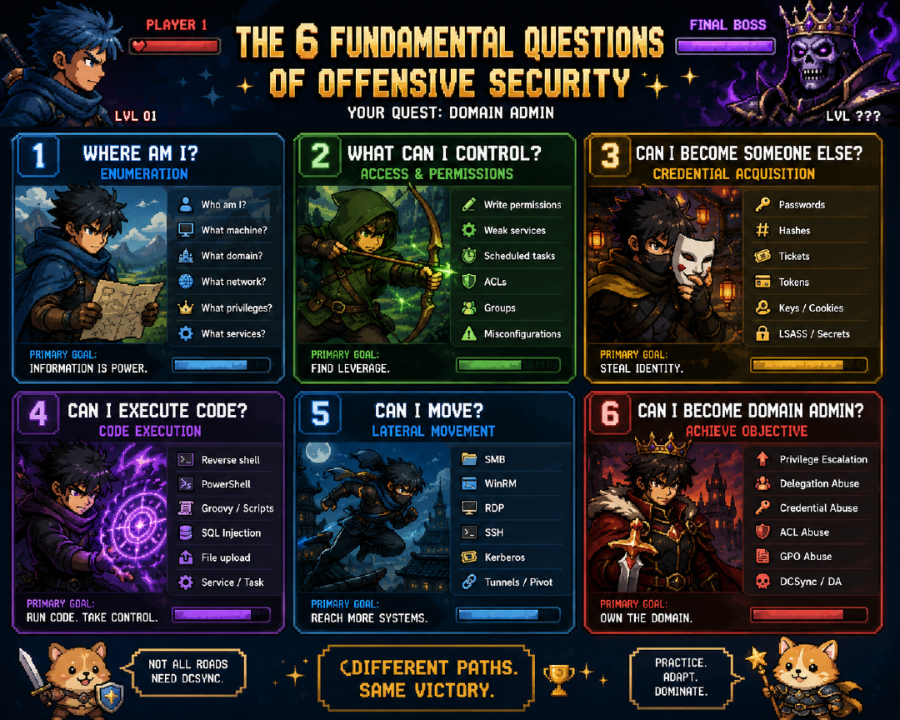

# Cybersecurity

## CTF / Interview Challenge Cheat Sheet

Living document. New line added every time something new comes along — that's the whole point. 

### 1. First move on ANY weird-looking text/output

1. Copy it into **CyberChef** and hit the **Magic wand** (auto-detects most encodings/ciphers).
2. If Magic doesn't nail it, check **dcode.fr** by pasting the sample — it has a solver index for nearly every named cipher.
3. Grep everything (files, responses, decoded output) against the flag format immediately, e.g. `grep -Eo 'flag\{[^}]+\}'`.

### 2. Encoding/Cipher Recognition Table

| Looks like | Usually is | Fastest fix |
| --- | --- | --- |
| Letters only, weirdly readable-ish | ROT13 / Caesar | CyberChef "ROT13" or brute all 25 shifts |
| `A-Za-z0-9+/=` blocks | Base64 | `base64 -d` or CyberChef |
| Only `0-9a-f`, even length | Hex | `xxd -r -p` or CyberChef "From Hex" |
| Only `01` characters | Binary | CyberChef "From Binary" |
| `.-` and spaces | Morse | CyberChef "From Morse Code" |
| `><+-.,[]` soup | Brainfuck | CyberChef "From Brainfuck" or an online BF interpreter |
| ASCII cow/animal saying your input | `cowsay`/`cowthink`/`figlet` piped output — decoy formatting, real data is usually inside the speech bubble or a hidden flag elsewhere in output | Ignore the art, read the text; check for hidden chars around it |
| Repeating short garbage, key-like feel | XOR w/ short key | CyberChef "XOR Brute Force" |
| Text ends in `==` or `=` | Base64 padding | Confirms base64 |
| Long token, 3 dot-separated base64 chunks | JWT | jwt.io or CyberChef JWT recipe; check `alg: none` and weak-secret brute force |
| File won't open / wrong magic bytes | Wrong extension or embedded file | `file <name>`, `binwalk`, fix header bytes |
| Image looks normal but too big/odd size | Steganography | `steghide`, `zsteg`, `exiftool`, check LSBs, check PNG chunks with `pngcheck` |
| Nested archive | Zip bomb / matryoshka | `binwalk -e`, unzip recursively, watch for password-protected layers (`fcrackzip`) |

### 3. Blind Black-Box Fuzzing Methodology (structured, not random)

**Step 1 — Enumerate the surface before touching payloads**

- Params, headers, cookies, hidden form fields, file upload fields, API routes.
- Directory/endpoint discovery: `ffuf`, `gobuster`, `feroxbuster` + SecLists wordlists.

**Step 2 — Fuzz with real wordlists, not randomness**

- SecLists (`Fuzzing/`, `Discovery/Web-Content/`) is the default source.
- `ffuf -w wordlist.txt -u https://target/FUZZ` for endpoints.
- `ffuf -w wordlist.txt -u https://target/?param=FUZZ` for param values.

**Step 3 — Watch for behavior deltas, not just direct hits**

- Response length changes, status code changes, timing differences, error message differences.
- These often reveal the real vector before any flag text appears.

**Step 4 — Automate detection of the flag format**

- Once you know the format (`flag{...}`, `CTF{...}`, etc.), regex-grep every response body/output automatically instead of eyeballing.

**Step 5 — Keep a hit log**

- Every interesting response/anomaly gets logged with payload + result, so you're not re-testing the same thing blind.

### 4. Practice Sources (ranked for "interview CTF" style specifically)

1. **picoCTF** — best single source for the classic encoding/misc pattern library.
2. **OverTheWire (Bandit, Natas)** — blind enumeration and shell fundamentals.
3. **HackTheBox "Starting Point" + CTF challenges** — closer to interview puzzle style than full OSCP-style boxes.
4. **CyberChef** (tool, not a range) — live in this during any challenge.

### 5. Postmortem Habit

After every CTF: spend 10 minutes listing anything you didn't immediately recognize, and add it to section 2 above. This compounds faster than doing more CTFs blind.

### 6. Box-Solving Training Checklist (interview prep)

**Enumeration discipline**

- Full port scan every time (`-p-`), not top-1000 — the box that gets you is always on the weird port.
- Service version banners, not just open/closed — version numbers are half of exploit-selection.
- Web: directory/vhost/subdomain fuzzing as a default step, not a "if nothing else works" fallback.
- Default creds / anonymous access checks (FTP, SMB, SNMP) before anything fancier.
- Write enum output to files as you go, not just scrollback.

**Pattern-to-technique mapping (connect-the-dots muscle)**

- After enum, explicitly ask "what does this *combination* of findings suggest" before reaching for a scanner/exploit-db search. Pause and reason before googling.
- Keep a running "service → common attack vectors" mental map (outdated CMS → known CVEs + config files; SMB → null sessions + share enum; exposed `.git` → source disclosure) so it's pattern-matching, not starting from zero each time.

**Privesc reflexes**

- Run `linpeas`/`winpeas` (or manual equivalent) as a first move on landing a shell; read the output methodically instead of skimming for "the answer."
- Checklist every time, in order: sudo -l, SUID binaries, cron jobs, writable PATH entries, stored creds in configs/history files.

**Speed and friction**

- Time yourself — interview practicals are often timeboxed, so untimed practice builds the wrong instinct.
- Build a personal snippets file (reverse shell one-liners, common privesc commands, enum command templates) to avoid re-typing/re-googling boilerplate under pressure.

**Communication layer (interview-specific)**

- Practice narrating your thought process out loud while solving — "got the flag" silently is a worse signal than "explained reasoning, got the flag" when the exercise is watched or needs a writeup.
- Write a short post-solve summary (what you found, why you tried X, what worked) for boxes you solve — this is often literally the deliverable format a pentest interview exercise wants.

**Failure review habit**

- For every box you needed a walkthrough on, categorize why:
  1. Unknown CVE/trivia you'd never have found cold — low value, don't rabbit-hole it.
  2. Genuine technique/tool gap you'd never seen — real gap, note it and move on.
  3. Had the puzzle pieces and didn't connect them — the trainable one, worth deliberate drilling.

### 7. Manual Source Code Review / White-Box Prep

For interviews where grey/white-box testing is explicitly core (not just black-box CTF boxes).

**Mindset shift from black-box**

- You're not looking for "what breaks when I poke it," you're looking for "where does trust get misplaced in this code." Read for data flow: where does user input enter, and every place it's used without being re-validated or re-encoded.
- Practice explaining root cause from the code itself, not just "I ran payload X and it worked." Be ready to point at the exact line and explain *why* it's exploitable.

**Checklist to run on any codebase**

- Trace all user-controlled input sources (HTTP params, headers, cookies, file uploads, deserialized objects, DB reads that originated from user input).
- Follow each one to its sinks: SQL queries, shell/process exec, file path construction, template rendering, deserialization, eval-like functions, SSRF-prone HTTP calls.
- Check auth/authz at the function level, not just the route level — look for missing checks on internal functions reachable from multiple routes (IDOR root causes live here).
- Check for insecure defaults: hardcoded secrets/keys, debug flags left on, overly permissive CORS, weak crypto (ECB mode, static IVs, MD5/SHA1 for passwords).
- Dependency check: outdated libraries with known CVEs (`npm audit`, `pip-audit`, `safety`, Snyk) — white-box access makes this trivial, don't skip it.
- Diff-based thinking: if you have git history, check recent commits/PRs for security-relevant changes (auth logic, input handling) — regressions hide there.

**Tools**

- `semgrep` — fast pattern-based static analysis, good for a first pass across a codebase.
- `grep`/`ripgrep` for manual sweeps: dangerous sinks (`eval`, `exec`, `pickle.loads`, raw SQL string concat, `subprocess` with `shell=True`).
- Language-specific SAST as a supplement, never a replacement for manual review (tools miss business-logic flaws entirely).

**Practice sources**

- OWASP WebGoat / Juice Shop source (not just playing them black-box — read the vulnerable source and map it to the exploit).
- PentesterLab's source-code-review-flavored exercises.
- Pick a CVE in a small open-source project, read the patch diff, then try to find the vuln in the pre-patch code yourself before looking at the writeup.

